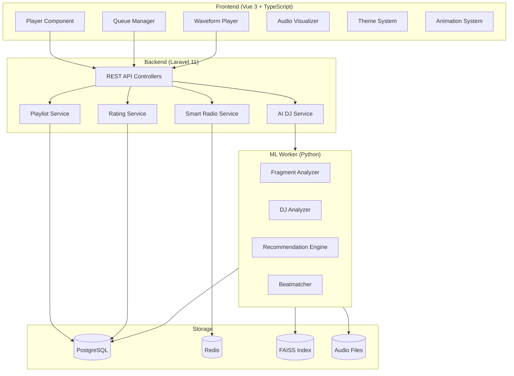

# Дизайн-документ: Продвинутая система музыкального плеера

## Обзор

Данный документ описывает архитектуру и технический дизайн продвинутой системы музыкального плеера, расширяющей существующую систему рекомендаций. Система включает шесть основных функциональных блоков:

1. **Умный плеер с плейлистами** — полнофункциональный аудиоплеер с очередью, режимами воспроизведения и crossfade
2. **Система рейтинга фрагментов** — оценка временных диапазонов с комментариями и визуализацией
3. **5-звёздочная система оценки** — гранулярный рейтинг треков с историей изменений
4. **Умное радио** — автоматический подбор треков на основе предпочтений
5. **Современный UI/UX** — тёмная тема, анимации, визуализация
6. **AI DJ система** — гармонический анализ, beatmatching, автоматические переходы

### Технологический стек

- **Backend**: Laravel 11, PHP 8.2+, PostgreSQL
- **Frontend**: Vue 3, TypeScript, Tailwind CSS
- **Аудио**: Web Audio API, Wavesurfer.js
- **ML**: Python, Essentia, TensorFlow, FAISS
- **Очередь**: Redis, Laravel Horizon

## Архитектура



## Компоненты и интерфейсы

### 1. Player Component (Frontend)

Центральный компонент управления воспроизведением.

```typescript
interface PlayerState {
  currentTrack: Track | null;
  queue: QueueItem[];
  isPlaying: boolean;
  currentTime: number;
  duration: number;
  volume: number;
  isMuted: boolean;
  shuffleMode: boolean;
  repeatMode: 'off' | 'all' | 'one';
  crossfadeEnabled: boolean;
  crossfadeDuration: number; // 0-12 seconds
  smartRadioEnabled: boolean;
  aiDjEnabled: boolean;
}

interface QueueItem {
  id: string;
  track: Track;
  addedAt: Date;
  source: 'manual' | 'playlist' | 'radio' | 'ai_dj';
  originalIndex: number; // for shuffle restore
}

interface PlayerActions {
  play(): void;
  pause(): void;
  stop(): void;
  next(): void;
  previous(): void;
  seek(time: number): void;
  setVolume(volume: number): void;
  addToQueue(track: Track, position?: 'end' | 'next'): void;
  removeFromQueue(itemId: string): void;
  reorderQueue(fromIndex: number, toIndex: number): void;
  clearQueue(): void;
  toggleShuffle(): void;
  setRepeatMode(mode: 'off' | 'all' | 'one'): void;
  setCrossfade(enabled: boolean, duration?: number): void;
}
```

### 2. Crossfade Engine

Реализация плавных переходов между треками через Web Audio API.

```typescript
interface CrossfadeEngine {
  // Два аудио-контекста для наложения
  currentSource: AudioBufferSourceNode | null;
  nextSource: AudioBufferSourceNode | null;
  
  // Gain nodes для управления громкостью
  currentGain: GainNode;
  nextGain: GainNode;
  
  // Методы
  prepareCrossfade(nextTrack: Track): Promise<void>;
  executeCrossfade(duration: number): void;
  cancelCrossfade(): void;
}

// Алгоритм crossfade
function executeCrossfade(duration: number): void {
  const startTime = audioContext.currentTime;
  const endTime = startTime + duration;
  
  // Линейное затухание текущего трека
  currentGain.gain.setValueAtTime(1, startTime);
  currentGain.gain.linearRampToValueAtTime(0, endTime);
  
  // Линейное нарастание следующего трека
  nextGain.gain.setValueAtTime(0, startTime);
  nextGain.gain.linearRampToValueAtTime(1, endTime);
  
  // Запуск следующего трека
  nextSource.start(startTime);
}
```

### 3. Playlist Service (Backend)

```php
interface PlaylistServiceInterface
{
    public function create(string $name, ?string $description = null): Playlist;
    public function update(int $playlistId, array $data): Playlist;
    public function delete(int $playlistId): void;
    public function addTrack(int $playlistId, int $trackId, ?int $position = null): void;
    public function removeTrack(int $playlistId, int $trackId): void;
    public function reorderTracks(int $playlistId, array $trackOrder): void;
    public function generateAiPlaylist(AiPlaylistParams $params): Playlist;
}

class AiPlaylistParams
{
    public ?int $duration; // minutes
    public ?string $genre;
    public ?string $mood;
    public ?int $minBpm;
    public ?int $maxBpm;
    public ?int $trackCount;
}
```

### 4. Fragment Rating System

```php
// Migration: add comment and is_liked fields to fragments
Schema::table('fragments', function (Blueprint $table) {
    $table->boolean('is_liked')->nullable()->change(); // null = not rated, true = liked, false = disliked
    $table->text('comment')->nullable();
    $table->timestamp('rated_at')->nullable();
});

interface FragmentRatingServiceInterface
{
    public function rateFragment(int $trackId, float $startTime, float $endTime, bool $isLiked): Fragment;
    public function updateRating(int $fragmentId, bool $isLiked): Fragment;
    public function removeRating(int $fragmentId): void;
    public function addComment(int $fragmentId, string $comment): Fragment;
    public function getFragmentsForTrack(int $trackId): Collection;
    public function getLikedFragments(): Collection;
    public function getDislikedFragments(): Collection;
}
```

### 5. Track Rating System (5-star)

```php
// Migration: track_ratings table
Schema::create('track_ratings', function (Blueprint $table) {
    $table->id();
    $table->foreignId('track_id')->constrained()->onDelete('cascade');
    $table->tinyInteger('rating')->unsigned(); // 1-5
    $table->timestamps();
    
    $table->unique('track_id'); // one rating per track (single user system)
});

// Migration: rating_history table
Schema::create('rating_history', function (Blueprint $table) {
    $table->id();
    $table->foreignId('track_id')->constrained()->onDelete('set null');
    $table->tinyInteger('old_rating')->unsigned()->nullable();
    $table->tinyInteger('new_rating')->unsigned()->nullable();
    $table->timestamp('changed_at');
});

interface TrackRatingServiceInterface
{
    public function setRating(int $trackId, int $rating): TrackRating;
    public function removeRating(int $trackId): void;
    public function getRating(int $trackId): ?int;
    public function getHistory(int $trackId): Collection;
    public function getTracksWithRating(int $minRating): Collection;
}
```

### 6. Smart Radio Service

```php
interface SmartRadioServiceInterface
{
    public function enable(int $seedTrackId): void;
    public function disable(): void;
    public function getNextRecommendations(int $count = 5): Collection;
    public function recordFeedback(int $trackId, string $type): void; // 'more' | 'less'
    public function recordSkip(int $trackId, float $positionAtSkip): void;
}

class SmartRadioState
{
    public bool $enabled = false;
    public ?int $seedTrackId = null;
    public array $recentlyPlayed = []; // track_ids with timestamps
    public array $feedbackWeights = []; // track_id => weight adjustment
    public array $excludedArtists = []; // for diversity
}
```

### 7. AI DJ Analyzer (Python ML Worker)

```python
from dataclasses import dataclass
from typing import List, Tuple, Optional
import essentia.standard as es

@dataclass
class DJAnalysisResult:
    track_id: int
    camelot_key: str  # e.g., "8A", "11B"
    bpm: float
    energy_level: int  # 1-10
    intro_point: float  # seconds
    outro_point: float  # seconds
    drop_points: List[float]
    breakdown_points: List[float]

class AIDJAnalyzer:
    def __init__(self):
        self.key_detector = es.KeyExtractor()
        self.bpm_detector = es.RhythmExtractor2013()
        self.energy_detector = es.Energy()
        
    def analyze(self, audio_path: str, track_id: int) -> DJAnalysisResult:
        audio = es.MonoLoader(filename=audio_path)()
        
        # Key detection -> Camelot conversion
        key, scale, strength = self.key_detector(audio)
        camelot_key = self._to_camelot(key, scale)
        
        # BPM detection
        bpm, beats, _, _, _ = self.bpm_detector(audio)
        
        # Energy level (normalized to 1-10)
        energy = self._calculate_energy_level(audio)
        
        # Structure analysis
        intro, outro, drops, breakdowns = self._analyze_structure(audio, beats)
        
        return DJAnalysisResult(
            track_id=track_id,
            camelot_key=camelot_key,
            bpm=round(bpm, 2),
            energy_level=energy,
            intro_point=intro,
            outro_point=outro,
            drop_points=drops,
            breakdown_points=breakdowns
        )
    
    def _to_camelot(self, key: str, scale: str) -> str:
        """Convert musical key to Camelot notation."""
        camelot_map = {
            ('C', 'major'): '8B', ('A', 'minor'): '8A',
            ('G', 'major'): '9B', ('E', 'minor'): '9A',
            ('D', 'major'): '10B', ('B', 'minor'): '10A',
            ('A', 'major'): '11B', ('F#', 'minor'): '11A',
            ('E', 'major'): '12B', ('C#', 'minor'): '12A',
            ('B', 'major'): '1B', ('G#', 'minor'): '1A',
            ('F#', 'major'): '2B', ('D#', 'minor'): '2A',
            ('Db', 'major'): '3B', ('Bb', 'minor'): '3A',
            ('Ab', 'major'): '4B', ('F', 'minor'): '4A',
            ('Eb', 'major'): '5B', ('C', 'minor'): '5A',
            ('Bb', 'major'): '6B', ('G', 'minor'): '6A',
            ('F', 'major'): '7B', ('D', 'minor'): '7A',
        }
        return camelot_map.get((key, scale), '1A')
```

### 8. AI DJ Matcher

```python
@dataclass
class CompatibilityScore:
    track_id: int
    total_score: float  # 0-100
    key_score: float
    bpm_score: float
    energy_score: float
    rating_bonus: float

class AIDJMatcher:
    CAMELOT_COMPATIBLE = {
        '1A': ['12A', '1A', '2A', '1B'],
        '1B': ['12B', '1B', '2B', '1A'],
        # ... full wheel mapping
    }
    
    def find_compatible_tracks(
        self, 
        current_track: DJAnalysisResult,
        candidates: List[DJAnalysisResult],
        ratings: Dict[int, int]
    ) -> List[CompatibilityScore]:
        scores = []
        
        for candidate in candidates:
            key_score = self._calculate_key_score(
                current_track.camelot_key, 
                candidate.camelot_key
            )
            bpm_score = self._calculate_bpm_score(
                current_track.bpm, 
                candidate.bpm
            )
            energy_score = self._calculate_energy_score(
                current_track.energy_level, 
                candidate.energy_level
            )
            rating_bonus = self._calculate_rating_bonus(
                ratings.get(candidate.track_id, 0)
            )
            
            total = (key_score * 0.4 + bpm_score * 0.3 + 
                    energy_score * 0.2 + rating_bonus * 0.1)
            
            scores.append(CompatibilityScore(
                track_id=candidate.track_id,
                total_score=total,
                key_score=key_score,
                bpm_score=bpm_score,
                energy_score=energy_score,
                rating_bonus=rating_bonus
            ))
        
        return sorted(scores, key=lambda x: x.total_score, reverse=True)[:10]
    
    def _calculate_key_score(self, key1: str, key2: str) -> float:
        if key1 == key2:
            return 100.0
        if key2 in self.CAMELOT_COMPATIBLE.get(key1, []):
            return 85.0
        return 0.0
    
    def _calculate_bpm_score(self, bpm1: float, bpm2: float) -> float:
        diff_percent = abs(bpm1 - bpm2) / bpm1 * 100
        if diff_percent <= 3:
            return 100.0
        elif diff_percent <= 6:
            return 80.0 - (diff_percent - 3) * 6.67
        elif diff_percent <= 8:
            return 60.0 - (diff_percent - 6) * 15
        return 0.0
```

### 9. Beatmatcher (Web Audio API)

```typescript
interface BeatmatcherConfig {
  maxBpmAdjustment: number; // default 8%
  beatGridResolution: number; // ms, default 10
  transitionDuration: number; // bars, default 16
}

class Beatmatcher {
  private audioContext: AudioContext;
  private currentSource: AudioBufferSourceNode | null = null;
  private nextSource: AudioBufferSourceNode | null = null;
  
  async prepareBeatmatch(
    currentTrack: DJAnalysisResult,
    nextTrack: DJAnalysisResult,
    nextAudioBuffer: AudioBuffer
  ): Promise<BeatmatchResult> {
    const bpmRatio = currentTrack.bpm / nextTrack.bpm;
    const adjustmentPercent = Math.abs(1 - bpmRatio) * 100;
    
    if (adjustmentPercent > this.config.maxBpmAdjustment) {
      return {
        success: false,
        warning: `BPM difference too large: ${adjustmentPercent.toFixed(1)}%`
      };
    }
    
    // Time-stretch next track to match current BPM
    const stretchedBuffer = await this.timeStretch(nextAudioBuffer, bpmRatio);
    
    // Find optimal mix point (on beat grid)
    const mixInPoint = this.findOptimalMixPoint(
      currentTrack.outro_point,
      nextTrack.intro_point,
      currentTrack.bpm
    );
    
    return {
      success: true,
      stretchedBuffer,
      mixInPoint,
      bpmRatio
    };
  }
  
  private async timeStretch(
    buffer: AudioBuffer, 
    ratio: number
  ): Promise<AudioBuffer> {
    // Phase vocoder implementation for time-stretching
    // Preserves pitch while changing tempo
    const offlineContext = new OfflineAudioContext(
      buffer.numberOfChannels,
      Math.ceil(buffer.length * ratio),
      buffer.sampleRate
    );
    
    // ... phase vocoder algorithm
    return offlineContext.startRendering();
  }
}
```

### 10. Theme System (Frontend)

```typescript
interface ThemeConfig {
  name: 'dark' | 'light';
  colors: {
    background: string;
    surface: string;
    primary: string;
    accent: string;
    text: string;
    textSecondary: string;
    success: string;
    error: string;
  };
  gradients: {
    playerBackground: string;
  };
}

const darkTheme: ThemeConfig = {
  name: 'dark',
  colors: {
    background: '#121212',
    surface: '#1e1e1e',
    primary: '#1DB954',
    accent: '#1ed760',
    text: '#ffffff',
    textSecondary: '#b3b3b3',
    success: '#1DB954',
    error: '#f44336',
  },
  gradients: {
    playerBackground: 'linear-gradient(180deg, var(--dominant-color) 0%, #121212 100%)',
  }
};

// Dynamic gradient based on album art
function extractDominantColor(imageUrl: string): Promise<string> {
  return new Promise((resolve) => {
    const img = new Image();
    img.crossOrigin = 'anonymous';
    img.onload = () => {
      const canvas = document.createElement('canvas');
      const ctx = canvas.getContext('2d')!;
      canvas.width = img.width;
      canvas.height = img.height;
      ctx.drawImage(img, 0, 0);
      
      const imageData = ctx.getImageData(0, 0, canvas.width, canvas.height);
      const dominantColor = getDominantColor(imageData.data);
      resolve(dominantColor);
    };
    img.src = imageUrl;
  });
}
```

### 11. Audio Visualizer

```typescript
class AudioVisualizer {
  private analyser: AnalyserNode;
  private dataArray: Uint8Array;
  private canvas: HTMLCanvasElement;
  private ctx: CanvasRenderingContext2D;
  private mode: 'bars' | 'wave' | 'circular' | 'particles' = 'bars';
  
  constructor(audioContext: AudioContext, canvas: HTMLCanvasElement) {
    this.analyser = audioContext.createAnalyser();
    this.analyser.fftSize = 256;
    this.dataArray = new Uint8Array(this.analyser.frequencyBinCount);
    this.canvas = canvas;
    this.ctx = canvas.getContext('2d')!;
  }
  
  connect(source: AudioNode): void {
    source.connect(this.analyser);
  }
  
  draw(): void {
    requestAnimationFrame(() => this.draw());
    this.analyser.getByteFrequencyData(this.dataArray);
    
    switch (this.mode) {
      case 'bars':
        this.drawBars();
        break;
      case 'wave':
        this.drawWave();
        break;
      case 'circular':
        this.drawCircular();
        break;
      case 'particles':
        this.drawParticles();
        break;
    }
  }
  
  private drawBars(): void {
    const barWidth = this.canvas.width / this.dataArray.length;
    this.ctx.clearRect(0, 0, this.canvas.width, this.canvas.height);
    
    this.dataArray.forEach((value, i) => {
      const barHeight = (value / 255) * this.canvas.height;
      const x = i * barWidth;
      const y = this.canvas.height - barHeight;
      
      // Gradient from accent to primary
      const gradient = this.ctx.createLinearGradient(x, y, x, this.canvas.height);
      gradient.addColorStop(0, '#1ed760');
      gradient.addColorStop(1, '#1DB954');
      
      this.ctx.fillStyle = gradient;
      this.ctx.fillRect(x, y, barWidth - 1, barHeight);
    });
  }
}
```

## Модели данных

### Новые таблицы

```sql
-- Плейлисты
CREATE TABLE playlists (
    id SERIAL PRIMARY KEY,
    name VARCHAR(255) NOT NULL,
    description TEXT,
    is_ai_generated BOOLEAN DEFAULT FALSE,
    track_count INTEGER DEFAULT 0,
    total_duration INTEGER DEFAULT 0, -- seconds
    created_at TIMESTAMP DEFAULT CURRENT_TIMESTAMP,
    updated_at TIMESTAMP DEFAULT CURRENT_TIMESTAMP
);

-- Связь плейлист-трек
CREATE TABLE playlist_tracks (
    id SERIAL PRIMARY KEY,
    playlist_id INTEGER REFERENCES playlists(id) ON DELETE CASCADE,
    track_id INTEGER REFERENCES tracks(id) ON DELETE CASCADE,
    position INTEGER NOT NULL,
    added_at TIMESTAMP DEFAULT CURRENT_TIMESTAMP,
    UNIQUE(playlist_id, track_id)
);

-- Рейтинги треков (5 звёзд)
CREATE TABLE track_ratings (
    id SERIAL PRIMARY KEY,
    track_id INTEGER REFERENCES tracks(id) ON DELETE CASCADE UNIQUE,
    rating SMALLINT CHECK (rating >= 1 AND rating <= 5),
    created_at TIMESTAMP DEFAULT CURRENT_TIMESTAMP,
    updated_at TIMESTAMP DEFAULT CURRENT_TIMESTAMP
);

-- История рейтингов
CREATE TABLE rating_history (
    id SERIAL PRIMARY KEY,
    track_id INTEGER REFERENCES tracks(id) ON DELETE SET NULL,
    old_rating SMALLINT,
    new_rating SMALLINT,
    changed_at TIMESTAMP DEFAULT CURRENT_TIMESTAMP
);

-- Пользовательские настройки треков
CREATE TABLE user_track_preferences (
    id SERIAL PRIMARY KEY,
    track_id INTEGER REFERENCES tracks(id) ON DELETE CASCADE UNIQUE,
    volume REAL DEFAULT 1.0,
    last_position REAL DEFAULT 0,
    updated_at TIMESTAMP DEFAULT CURRENT_TIMESTAMP
);

-- История прослушивания
CREATE TABLE listening_history (
    id SERIAL PRIMARY KEY,
    track_id INTEGER REFERENCES tracks(id) ON DELETE CASCADE,
    started_at TIMESTAMP DEFAULT CURRENT_TIMESTAMP,
    duration_played REAL, -- seconds
    completed BOOLEAN DEFAULT FALSE,
    source VARCHAR(50) -- 'queue', 'playlist', 'radio', 'ai_dj'
);

-- Пропуски треков
CREATE TABLE track_skips (
    id SERIAL PRIMARY KEY,
    track_id INTEGER REFERENCES tracks(id) ON DELETE CASCADE,
    position_at_skip REAL,
    source VARCHAR(50),
    skipped_at TIMESTAMP DEFAULT CURRENT_TIMESTAMP
);

-- Обратная связь Smart Radio
CREATE TABLE radio_feedback (
    id SERIAL PRIMARY KEY,
    track_id INTEGER REFERENCES tracks(id) ON DELETE CASCADE,
    feedback_type VARCHAR(10) CHECK (feedback_type IN ('more', 'less')),
    created_at TIMESTAMP DEFAULT CURRENT_TIMESTAMP
);

-- DJ-анализ треков
CREATE TABLE track_dj_analysis (
    id SERIAL PRIMARY KEY,
    track_id INTEGER REFERENCES tracks(id) ON DELETE CASCADE UNIQUE,
    camelot_key VARCHAR(3),
    bpm REAL,
    energy_level SMALLINT CHECK (energy_level >= 1 AND energy_level <= 10),
    intro_point REAL,
    outro_point REAL,
    drop_points JSONB DEFAULT '[]',
    breakdown_points JSONB DEFAULT '[]',
    analyzed_at TIMESTAMP DEFAULT CURRENT_TIMESTAMP
);

-- Пользовательские настройки (тема, анимации и т.д.)
CREATE TABLE user_settings (
    id SERIAL PRIMARY KEY,
    key VARCHAR(100) UNIQUE NOT NULL,
    value JSONB NOT NULL,
    updated_at TIMESTAMP DEFAULT CURRENT_TIMESTAMP
);
```

### Изменения существующих таблиц

```sql
-- Добавление полей в fragments
ALTER TABLE fragments 
ADD COLUMN comment TEXT,
ADD COLUMN rated_at TIMESTAMP;

-- Изменение is_liked на nullable (null = not rated)
ALTER TABLE fragments 
ALTER COLUMN is_liked DROP NOT NULL;
```


## Свойства корректности

*Свойство корректности — это характеристика или поведение, которое должно выполняться для всех допустимых входных данных системы. Свойства служат мостом между человекочитаемыми спецификациями и машинно-проверяемыми гарантиями корректности.*

### Property 1: Инварианты очереди воспроизведения

*Для любой* очереди воспроизведения и любого трека:
- Добавление трека в конец увеличивает длину очереди на 1, и трек находится на последней позиции
- Удаление трека уменьшает длину очереди на 1, и трек отсутствует в очереди
- Очистка очереди оставляет только текущий воспроизводимый трек (если есть)

**Validates: Requirements 1.1, 1.4, 1.5**

### Property 2: Round-trip для режима Shuffle

*Для любой* очереди воспроизведения, включение режима Shuffle с последующим выключением должно вернуть очередь к исходному порядку. При этом:
- Shuffle сохраняет все треки (только меняет порядок)
- Unshuffle восстанавливает originalIndex каждого элемента

**Validates: Requirements 2.1, 2.2**

### Property 3: Громкость при Crossfade

*Для любого* момента времени t в интервале crossfade [0, duration]:
- currentVolume(t) + nextVolume(t) ≈ 1.0 (с допуском ±0.1)
- currentVolume монотонно убывает от 1 до 0
- nextVolume монотонно возрастает от 0 до 1

**Validates: Requirements 3.2**

### Property 4: Валидация длительности Crossfade

*Для любого* значения длительности crossfade:
- Значения в диапазоне [0, 12] принимаются
- Значения вне диапазона отклоняются или приводятся к границам
- Если следующий трек короче crossfade, длительность адаптируется к min(настройка, длительность_трека)

**Validates: Requirements 3.3, 3.5**

### Property 5: Round-trip для пользовательских настроек трека

*Для любого* трека и любых настроек (громкость, позиция):
- Сохранение настройки с последующим получением возвращает то же значение
- Удаление трека каскадно удаляет связанные настройки

**Validates: Requirements 4.1, 4.2, 4.5**

### Property 6: Целостность плейлистов

*Для любого* плейлиста и набора треков:
- Добавление трека увеличивает track_count на 1
- Удаление трека из плейлиста не удаляет трек из библиотеки
- Удаление плейлиста не удаляет треки из библиотеки
- Порядок треков сохраняется после reorder операции

**Validates: Requirements 5.2, 5.3, 5.4, 5.6**

### Property 7: Загрузка плейлиста в очередь

*Для любого* плейлиста с N треками, загрузка в очередь должна:
- Добавить ровно N треков в очередь
- Сохранить порядок треков из плейлиста
- Установить source='playlist' для каждого элемента очереди

**Validates: Requirements 5.7**

### Property 8: AI-плейлист соответствует фильтрам

*Для любого* AI-сгенерированного плейлиста с заданными параметрами:
- Все треки соответствуют указанному жанру (если задан)
- Все треки имеют BPM в указанном диапазоне (если задан)
- Плейлист имеет флаг is_ai_generated=true
- Треки с высоким рейтингом имеют приоритет

**Validates: Requirements 6.2, 6.4, 6.5**

### Property 9: Жизненный цикл рейтинга фрагментов

*Для любого* фрагмента трека:
- Создание с лайком устанавливает is_liked=true
- Создание с дизлайком устанавливает is_liked=false
- Изменение оценки обновляет is_liked
- Удаление оценки удаляет фрагмент из базы данных
- После оценки создаётся задача на ML-анализ

**Validates: Requirements 7.1, 7.2, 7.3, 7.4, 7.7**

### Property 10: Round-trip для комментариев к фрагментам

*Для любого* фрагмента и текста комментария (до 500 символов):
- Сохранение комментария с последующим получением возвращает тот же текст
- Комментарии длиннее 500 символов отклоняются или обрезаются
- Удаление комментария устанавливает comment=null

**Validates: Requirements 8.1, 8.2, 8.3, 8.4**

### Property 11: Фильтрация фрагментов по комментарию

*Для любой* коллекции фрагментов:
- Фильтр "с комментарием" возвращает только фрагменты где comment IS NOT NULL
- Фильтр "без комментария" возвращает только фрагменты где comment IS NULL

**Validates: Requirements 8.6**

### Property 12: Вес фрагментов пропорционален длительности

*Для любого* фрагмента с start_time и end_time:
- weight = (end_time - start_time) / track_duration
- Более длинные фрагменты имеют больший вес в рекомендациях

**Validates: Requirements 9.3**

### Property 13: Жизненный цикл 5-звёздочного рейтинга

*Для любого* трека и рейтинга (1-5):
- Установка рейтинга сохраняет значение
- Изменение рейтинга создаёт запись в Rating_History с old_rating и new_rating
- Удаление рейтинга устанавливает rating=NULL
- Рейтинги вне диапазона 1-5 отклоняются

**Validates: Requirements 11.1, 11.2, 11.3, 14.1**

### Property 14: Фильтрация треков по рейтингу

*Для любого* минимального рейтинга N:
- Фильтр "N+ звёзд" возвращает только треки с rating >= N
- Треки без рейтинга не включаются в результат

**Validates: Requirements 11.5**

### Property 15: Формула веса рейтинга в рекомендациях

*Для любого* рейтинга R (1-5):
- weight(5) = 1.0 (сильный положительный)
- weight(4) = 0.5
- weight(3) = 0.0 (нейтральный)
- weight(2) = -0.25
- weight(1) = -0.5 (отрицательный)
- Формула: weight = (R - 3) / 2

**Validates: Requirements 12.1, 12.2, 12.3, 12.4, 12.5**

### Property 16: Инвариант минимальной очереди Smart Radio

*Пока* Smart Radio активен:
- Очередь содержит минимум 3 трека (или все доступные, если меньше 3)
- Треки из последних 2 часов истории исключены из рекомендаций
- Треки из последних 24 часов имеют пониженный приоритет

**Validates: Requirements 15.2, 16.1, 16.2**

### Property 17: Обратная связь Smart Radio

*Для любого* трека и типа обратной связи:
- "Больше такого" увеличивает вес трека в feedbackWeights
- "Меньше такого" уменьшает вес трека в feedbackWeights
- Обратная связь сохраняется в radio_feedback таблице

**Validates: Requirements 17.1, 17.2, 17.4**

### Property 18: Отслеживание пропусков

*Для любого* пропуска трека в первые 30 секунд:
- Создаётся запись в track_skips с position_at_skip < 30
- После 3+ пропусков трек значительно понижается в рекомендациях

**Validates: Requirements 18.1, 18.3**

### Property 19: Валидность Camelot ключа

*Для любого* результата AI_DJ_Analyzer:
- camelot_key соответствует формату: число (1-12) + буква (A или B)
- energy_level в диапазоне 1-10
- intro_point < outro_point
- Все точки (intro, outro, drops, breakdowns) в пределах длительности трека

**Validates: Requirements 27.1, 27.3, 27.4**

### Property 20: Совместимость треков по Camelot Wheel

*Для любого* ключа на Camelot Wheel:
- Совместимые ключи: тот же ключ, ±1 по часовой стрелке, переход A↔B
- Например, для 8A совместимы: 7A, 8A, 9A, 8B
- Все рекомендованные треки имеют совместимый ключ

**Validates: Requirements 28.1**

### Property 21: BPM-совместимость для DJ микширования

*Для любого* текущего трека с BPM = X:
- Все рекомендованные треки имеют BPM в диапазоне [X * 0.94, X * 1.06]
- Time-stretching применяется только в пределах ±8%
- При разнице > 8% выдаётся предупреждение

**Validates: Requirements 28.2, 29.4, 29.5**

### Property 22: Time-stretching сохраняет длительность

*Для любого* аудиобуфера и коэффициента ratio:
- stretchedBuffer.duration ≈ originalBuffer.duration * ratio (с допуском ±1%)
- Pitch (тональность) сохраняется неизменной

**Validates: Requirements 29.2, 29.3**

## Обработка ошибок

### Player Errors

| Ошибка | Причина | Обработка |
|--------|---------|-----------|
| `AUDIO_LOAD_FAILED` | Файл повреждён или недоступен | Пропустить трек, показать уведомление |
| `CROSSFADE_BUFFER_ERROR` | Недостаточно памяти для буфера | Отключить crossfade, продолжить воспроизведение |
| `QUEUE_EMPTY` | Очередь пуста при попытке воспроизведения | Показать сообщение, предложить добавить треки |

### Rating Errors

| Ошибка | Причина | Обработка |
|--------|---------|-----------|
| `INVALID_RATING` | Рейтинг вне диапазона 1-5 | Отклонить, вернуть ошибку валидации |
| `FRAGMENT_OVERLAP` | Новый фрагмент перекрывает существующий | Предложить объединить или заменить |
| `COMMENT_TOO_LONG` | Комментарий > 500 символов | Обрезать или отклонить |

### Smart Radio Errors

| Ошибка | Причина | Обработка |
|--------|---------|-----------|
| `NO_RECOMMENDATIONS` | Нет подходящих треков | Расширить критерии поиска |
| `MODEL_NOT_TRAINED` | Preference Model не обучена | Использовать fallback на similarity search |
| `FAISS_INDEX_ERROR` | Ошибка векторного поиска | Использовать SQL-based поиск |

### AI DJ Errors

| Ошибка | Причина | Обработка |
|--------|---------|-----------|
| `BPM_MISMATCH_TOO_LARGE` | Разница BPM > 8% | Предупредить, предложить другой трек |
| `KEY_INCOMPATIBLE` | Ключи несовместимы | Показать предупреждение, разрешить override |
| `BEATMATCH_FAILED` | Не удалось синхронизировать биты | Использовать простой crossfade |
| `TIME_STRETCH_ARTIFACT` | Артефакты при растяжении | Уменьшить коэффициент или отключить |

## Стратегия тестирования

### Подход к тестированию

Используется двойной подход:
- **Unit tests**: Проверка конкретных примеров, edge cases, обработки ошибок
- **Property tests**: Проверка универсальных свойств на множестве сгенерированных входных данных

### Property-Based Testing

**Библиотека**: 
- PHP: `phpunit/phpunit` + `spatie/phpunit-snapshot-assertions`
- TypeScript: `fast-check`
- Python: `hypothesis`

**Конфигурация**: Минимум 100 итераций на каждый property test.

### Примеры Property Tests

```typescript
// TypeScript с fast-check
import fc from 'fast-check';

// Property 1: Queue invariants
describe('Queue', () => {
  it('adding track increases length by 1', () => {
    fc.assert(
      fc.property(
        fc.array(trackArbitrary()),
        fc.integer({ min: 0 }),
        (queue, trackId) => {
          const initialLength = queue.length;
          const newQueue = addToQueue(queue, { id: trackId });
          return newQueue.length === initialLength + 1;
        }
      ),
      { numRuns: 100 }
    );
  });
  // Feature: advanced-music-player, Property 1: Queue invariants
});

// Property 2: Shuffle round-trip
describe('Shuffle', () => {
  it('shuffle then unshuffle restores original order', () => {
    fc.assert(
      fc.property(
        fc.array(trackArbitrary(), { minLength: 1 }),
        (queue) => {
          const shuffled = shuffle(queue);
          const unshuffled = unshuffle(shuffled);
          return arraysEqual(queue, unshuffled);
        }
      ),
      { numRuns: 100 }
    );
  });
  // Feature: advanced-music-player, Property 2: Shuffle round-trip
});
```

```python
# Python с hypothesis
from hypothesis import given, strategies as st

# Property 19: Camelot key validation
@given(st.text())
def test_camelot_key_format(audio_path):
    """Feature: advanced-music-player, Property 19: Camelot key validation"""
    result = analyzer.analyze(audio_path)
    assert re.match(r'^(1[0-2]|[1-9])[AB]$', result.camelot_key)
    assert 1 <= result.energy_level <= 10

# Property 20: Camelot compatibility
@given(st.sampled_from(CAMELOT_KEYS))
def test_camelot_compatibility(key):
    """Feature: advanced-music-player, Property 20: Camelot compatibility"""
    compatible = get_compatible_keys(key)
    # Same key is always compatible
    assert key in compatible
    # Adjacent keys are compatible
    assert get_adjacent_key(key, +1) in compatible
    assert get_adjacent_key(key, -1) in compatible
```

```php
// PHP с PHPUnit
class TrackRatingTest extends TestCase
{
    /**
     * Feature: advanced-music-player, Property 13: Rating lifecycle
     * @dataProvider ratingProvider
     */
    public function testRatingLifecycle(int $rating): void
    {
        $track = Track::factory()->create();
        
        // Set rating
        $this->ratingService->setRating($track->id, $rating);
        $this->assertEquals($rating, $this->ratingService->getRating($track->id));
        
        // Change rating
        $newRating = ($rating % 5) + 1;
        $this->ratingService->setRating($track->id, $newRating);
        
        // Check history
        $history = $this->ratingService->getHistory($track->id);
        $this->assertEquals($rating, $history->last()->old_rating);
        $this->assertEquals($newRating, $history->last()->new_rating);
    }
    
    public function ratingProvider(): array
    {
        return [[1], [2], [3], [4], [5]];
    }
}
```

### Unit Test Coverage

| Компонент | Unit Tests | Property Tests |
|-----------|------------|----------------|
| Queue Management | Edge cases, empty queue | Invariants, ordering |
| Crossfade | Timing, volume curves | Volume sum = 1 |
| Playlist CRUD | Validation, cascades | Integrity constraints |
| Fragment Rating | Validation, overlaps | Lifecycle, round-trip |
| Track Rating | Range validation | Weight formula |
| Smart Radio | Empty library, no model | Queue minimum, exclusions |
| AI DJ Analyzer | Invalid audio | Key format, ranges |
| AI DJ Matcher | No compatible tracks | Compatibility rules |
| Beatmatcher | Large BPM diff | Time-stretch ratio |

