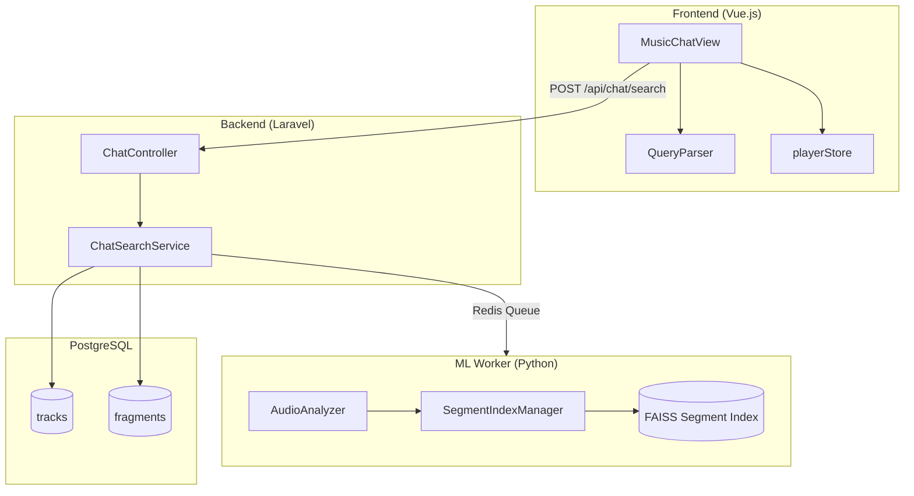

# Дизайн-документ: AI Music Chat

## Обзор

AI Music Chat реализует чат-интерфейс для поиска похожих музыкальных моментов по всей библиотеке. Система использует существующую инфраструктуру FAISS и AudioAnalyzer для извлечения эмбеддингов сегментов и поиска похожих фрагментов.

### Ключевые решения

1. **Расширение существующего FAISSManager** для поддержки индекса сегментов (отдельно от индекса треков)
2. **Использование AudioAnalyzer.extract_embeddings()** с параметрами start_time/end_time для извлечения эмбеддингов произвольных сегментов
3. **Новый Vue.js компонент MusicChatView** с чат-интерфейсом
4. **Laravel API endpoint** для обработки запросов поиска

## Архитектура



## Компоненты и интерфейсы

### 1. QueryParser (Frontend)

Модуль парсинга пользовательских запросов для извлечения временного диапазона.

```typescript
interface ParsedQuery {
  trackId: number | null;      // null = использовать текущий трек
  trackName: string | null;    // имя трека для поиска
  startTime: number;           // в секундах
  endTime: number;             // в секундах
  originalText: string;        // исходный текст запроса
}

interface ParseError {
  code: 'INVALID_TIME_FORMAT' | 'INVALID_RANGE' | 'TRACK_NOT_FOUND';
  message: string;
}

class QueryParser {
  /**
   * Парсит запрос пользователя и извлекает временной диапазон.
   * Поддерживаемые форматы:
   * - "00:29 - 00:35" (MM:SS - MM:SS)
   * - "29s - 35s" (Ns - Ms)
   * - "0:29 - 0:35" (M:SS - M:SS)
   */
  parse(query: string, currentTrackId?: number): ParsedQuery | ParseError;
  
  /**
   * Парсит строку времени в секунды.
   * "00:29" -> 29, "1:30" -> 90, "35s" -> 35
   */
  parseTime(timeStr: string): number | null;
  
  /**
   * Форматирует секунды в строку времени.
   * 29 -> "0:29", 90 -> "1:30"
   */
  formatTime(seconds: number): string;
}
```

### 2. SegmentIndexManager (Python)

Расширение FAISSManager для работы с индексом сегментов.

```python
class SegmentIndexManager:
    """
    Управляет FAISS индексом эмбеддингов сегментов.
    Отдельный индекс от track-level индекса.
    """
    
    def __init__(
        self,
        dimension: int = 1280,
        index_path: str = '/app/faiss_index/segments'
    ):
        """Инициализация индекса сегментов."""
        pass
    
    def add_segment(
        self,
        fragment_id: int,
        track_id: int,
        embedding: np.ndarray,
        start_time: float,
        end_time: float
    ) -> None:
        """Добавить эмбеддинг сегмента в индекс."""
        pass
    
    def remove_segment(self, fragment_id: int) -> None:
        """Удалить сегмент из индекса."""
        pass
    
    def search_similar(
        self,
        query_embedding: np.ndarray,
        k: int = 10,
        exclude_track_id: int | None = None,
        min_similarity: float = 0.0
    ) -> list[SegmentMatch]:
        """
        Поиск k похожих сегментов.
        
        Returns:
            Список SegmentMatch отсортированный по similarity (убывание)
        """
        pass
    
    def rebuild_index(self) -> None:
        """Перестроить индекс из всех фрагментов в БД."""
        pass

@dataclass
class SegmentMatch:
    fragment_id: int
    track_id: int
    start_time: float
    end_time: float
    similarity: float  # 0.0 - 1.0
```

### 3. ChatSearchService (Laravel)

Сервис обработки запросов поиска похожих сегментов.

```php
<?php

namespace App\Services;

class ChatSearchService
{
    /**
     * Поиск похожих сегментов по временному диапазону трека.
     *
     * @param int $trackId ID исходного трека
     * @param float $startTime Начало сегмента в секундах
     * @param float $endTime Конец сегмента в секундах
     * @param int $limit Максимальное количество результатов
     * @param float $minSimilarity Минимальный порог схожести (0.0-1.0)
     * @return array<SearchResult>
     */
    public function searchSimilarSegments(
        int $trackId,
        float $startTime,
        float $endTime,
        int $limit = 10,
        float $minSimilarity = 0.3
    ): array;
    
    /**
     * Извлечь эмбеддинг для произвольного сегмента трека.
     * Отправляет задачу в ML Worker и ждёт результат.
     */
    public function extractSegmentEmbedding(
        int $trackId,
        float $startTime,
        float $endTime
    ): array; // 1280-dim embedding
}

class SearchResult
{
    public int $trackId;
    public string $trackTitle;
    public ?string $artist;
    public float $startTime;
    public float $endTime;
    public float $similarity;
    public ?int $fragmentId; // null если это ad-hoc сегмент
}
```

### 4. ChatController (Laravel)

API контроллер для чат-запросов.

```php
<?php

namespace App\Http\Controllers;

class ChatController extends Controller
{
    /**
     * POST /api/chat/search
     * 
     * Request body:
     * {
     *   "track_id": 123,
     *   "start_time": 29.0,
     *   "end_time": 35.0,
     *   "limit": 10,
     *   "min_similarity": 0.3
     * }
     * 
     * Response:
     * {
     *   "query": { "track_id": 123, "start_time": 29.0, "end_time": 35.0 },
     *   "results": [
     *     {
     *       "track_id": 456,
     *       "track_title": "Similar Track",
     *       "artist": "Artist Name",
     *       "start_time": 45.0,
     *       "end_time": 51.0,
     *       "similarity": 0.87,
     *       "fragment_id": 789
     *     }
     *   ],
     *   "total": 5
     * }
     */
    public function search(Request $request): JsonResponse;
}
```

### 5. MusicChatView (Vue.js)

Компонент чат-интерфейса.

```typescript
interface ChatMessage {
  id: string;
  type: 'user' | 'system' | 'results';
  content: string;
  timestamp: Date;
  query?: ParsedQuery;
  results?: SearchResult[];
  isLoading?: boolean;
}

interface SearchResult {
  trackId: number;
  trackTitle: string;
  artist: string | null;
  startTime: number;
  endTime: number;
  similarity: number;
  fragmentId: number | null;
}

// Компонент MusicChatView.vue
// - Поле ввода запроса
// - История сообщений (user queries + system responses)
// - Отображение текущего трека и прогресса
// - Список результатов с мини-плеерами
// - Кнопки действий (play, like)
```

## Модели данных

### Расширение таблицы fragments

Существующая таблица `fragments` уже содержит необходимые поля:
- `embedding_path` - путь к файлу эмбеддинга
- `start_time`, `end_time` - временные границы
- `track_id` - связь с треком

### Новая таблица chat_history (опционально)

```sql
CREATE TABLE chat_history (
    id SERIAL PRIMARY KEY,
    session_id VARCHAR(64) NOT NULL,
    query_text TEXT NOT NULL,
    track_id INTEGER REFERENCES tracks(id),
    start_time FLOAT NOT NULL,
    end_time FLOAT NOT NULL,
    results_count INTEGER DEFAULT 0,
    created_at TIMESTAMP DEFAULT CURRENT_TIMESTAMP
);

CREATE INDEX idx_chat_history_session ON chat_history(session_id);
```

### Метаданные индекса сегментов

```python
# Структура файла segments_metadata.json
{
    "fragment_id": {
        "track_id": int,
        "start_time": float,
        "end_time": float,
        "faiss_idx": int
    }
}
```


## Свойства корректности

*Свойство корректности — это характеристика или поведение, которое должно выполняться для всех допустимых входных данных системы. Свойства служат мостом между человекочитаемыми спецификациями и машинно-проверяемыми гарантиями корректности.*

### Property 1: Парсинг времени round-trip

*Для любой* валидной строки времени в формате "MM:SS" или "Ns", парсинг в секунды и обратное форматирование должны давать эквивалентное значение времени.

**Validates: Requirements 1.1, 1.2**

### Property 2: Отклонение некорректных временных диапазонов

*Для любого* временного диапазона, где start_time >= end_time или любое значение отрицательно, Query_Parser должен вернуть ошибку типа ParseError.

**Validates: Requirements 1.5**

### Property 3: Ограничение временного диапазона длительностью трека

*Для любого* временного диапазона и трека с известной длительностью, если end_time > duration, то результирующий end_time должен быть равен duration трека.

**Validates: Requirements 1.6**

### Property 4: Инвариант добавления в индекс сегментов

*Для любого* фрагмента с эмбеддингом, после вызова add_segment(), индекс должен содержать этот фрагмент (contains() возвращает true).

**Validates: Requirements 2.1, 2.2**

### Property 5: Инвариант удаления из индекса сегментов

*Для любого* фрагмента, присутствующего в индексе, после вызова remove_segment(), индекс не должен содержать этот фрагмент (contains() возвращает false).

**Validates: Requirements 2.3**

### Property 6: Round-trip персистентности индекса

*Для любого* состояния индекса сегментов, сохранение на диск и последующая загрузка должны давать индекс с теми же фрагментами и эмбеддингами.

**Validates: Requirements 2.5**

### Property 7: Ограничение количества результатов поиска

*Для любого* запроса поиска с параметром limit=N, количество возвращённых результатов должно быть <= N.

**Validates: Requirements 3.2, 6.3**

### Property 8: Исключение исходного трека из результатов

*Для любого* запроса поиска с track_id, ни один результат не должен иметь track_id равный исходному track_id запроса.

**Validates: Requirements 3.4**

### Property 9: Полнота полей результата поиска

*Для любого* результата поиска, объект должен содержать все обязательные поля: track_id, track_title, start_time, end_time, similarity.

**Validates: Requirements 3.3**

### Property 10: Фильтрация по порогу схожести

*Для любого* запроса поиска с параметром min_similarity=T, все возвращённые результаты должны иметь similarity >= T.

**Validates: Requirements 6.4**

### Property 11: Валидация некорректных запросов API

*Для любого* запроса к API с некорректным временным диапазоном (start >= end, отрицательные значения), API должен вернуть HTTP статус 422.

**Validates: Requirements 6.6**

### Property 12: Round-trip персистентности истории чата

*Для любой* истории чата, сохранение в localStorage и последующая загрузка должны давать эквивалентную историю сообщений.

**Validates: Requirements 7.1**

### Property 13: Инвариант размера истории чата

*Для любого* состояния истории чата после добавления сообщения, количество сообщений должно быть <= 100.

**Validates: Requirements 7.4**

## Обработка ошибок

### Ошибки парсинга запросов

| Код ошибки | Описание | HTTP статус |
|------------|----------|-------------|
| INVALID_TIME_FORMAT | Неверный формат времени | 422 |
| INVALID_RANGE | start_time >= end_time | 422 |
| NEGATIVE_TIME | Отрицательное значение времени | 422 |
| TRACK_NOT_FOUND | Трек не найден по ID или имени | 404 |

### Ошибки поиска

| Код ошибки | Описание | HTTP статус |
|------------|----------|-------------|
| EMBEDDING_EXTRACTION_FAILED | Не удалось извлечь эмбеддинг | 500 |
| INDEX_NOT_AVAILABLE | Индекс сегментов недоступен | 503 |
| TIMEOUT | Превышено время ожидания ML worker | 504 |

### Обработка на фронтенде

```typescript
interface ChatError {
  code: string;
  message: string;
  details?: Record<string, unknown>;
}

// Отображение ошибок в чате как системных сообщений
// с понятным описанием и предложением действий
```

## Стратегия тестирования

### Unit-тесты

1. **QueryParser**
   - Парсинг различных форматов времени
   - Валидация некорректных диапазонов
   - Извлечение track_id из запроса

2. **SegmentIndexManager**
   - Добавление/удаление сегментов
   - Поиск k ближайших соседей
   - Сохранение/загрузка индекса

3. **ChatSearchService**
   - Формирование запросов к ML worker
   - Обработка результатов поиска
   - Фильтрация и сортировка

### Property-based тесты

Используем **fast-check** для TypeScript и **hypothesis** для Python.

Конфигурация: минимум 100 итераций на свойство.

```typescript
// Пример: Property 1 - Time parsing round-trip
// Feature: ai-music-chat, Property 1: Time parsing round-trip
fc.assert(
  fc.property(
    fc.integer({ min: 0, max: 3599 }), // 0-59:59
    (seconds) => {
      const formatted = formatTime(seconds);
      const parsed = parseTime(formatted);
      return parsed === seconds;
    }
  ),
  { numRuns: 100 }
);
```

```python
# Пример: Property 6 - Index persistence round-trip
# Feature: ai-music-chat, Property 6: Index persistence round-trip
@given(st.lists(st.tuples(
    st.integers(min_value=1),  # fragment_id
    st.integers(min_value=1),  # track_id
    arrays(np.float32, (1280,)),  # embedding
)))
def test_index_persistence_roundtrip(segments):
    index = SegmentIndexManager()
    for frag_id, track_id, emb in segments:
        index.add_segment(frag_id, track_id, emb, 0.0, 10.0)
    
    index.save()
    loaded_index = SegmentIndexManager()
    loaded_index.load()
    
    for frag_id, _, _ in segments:
        assert loaded_index.contains(frag_id)
```

### Интеграционные тесты

1. **API endpoint /api/chat/search**
   - Успешный поиск с валидными параметрами
   - Обработка ошибок 404, 422
   - Проверка структуры ответа

2. **Frontend-Backend интеграция**
   - Отправка запроса из MusicChatView
   - Отображение результатов
   - Воспроизведение с таймстампа

### Тестовые данные

- Набор тестовых треков с известными эмбеддингами
- Предварительно проиндексированные фрагменты
- Фикстуры для различных сценариев поиска
