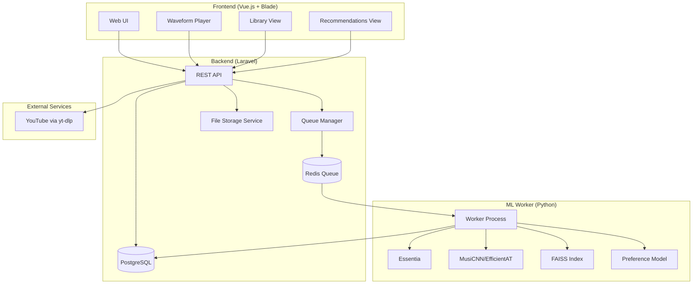
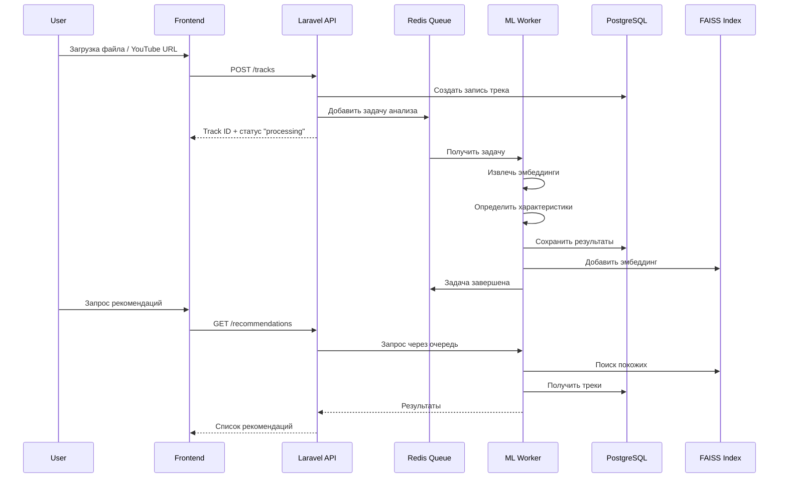

# Документ дизайна

## Обзор

Система персональных музыкальных рекомендаций представляет собой веб-приложение с микросервисной архитектурой, состоящее из Laravel-бэкенда, Vue.js-фронтенда и Python ML-воркера. Система обеспечивает загрузку аудио, автоматический ML-анализ, интерактивный waveform-плеер с разметкой фрагментов, обучение персональной модели предпочтений и генерацию рекомендаций.

## Архитектура



### Поток данных



## Компоненты и интерфейсы

### Backend (Laravel)

#### TrackController
```php
interface TrackControllerInterface {
    // Загрузка локального файла
    public function upload(Request $request): JsonResponse;
    
    // Импорт с YouTube
    public function importYoutube(Request $request): JsonResponse;
    
    // Получение списка треков
    public function index(Request $request): JsonResponse;
    
    // Получение трека по ID
    public function show(int $id): JsonResponse;
    
    // Удаление трека
    public function destroy(int $id): JsonResponse;
    
    // Обновление характеристик (ручная корректировка)
    public function update(int $id, Request $request): JsonResponse;
}
```

#### FragmentController
```php
interface FragmentControllerInterface {
    // Создание фрагмента
    public function store(int $trackId, Request $request): JsonResponse;
    
    // Получение фрагментов трека
    public function index(int $trackId): JsonResponse;
    
    // Удаление фрагмента
    public function destroy(int $trackId, int $fragmentId): JsonResponse;
}
```

#### LikeController
```php
interface LikeControllerInterface {
    // Лайк трека
    public function likeTrack(int $trackId): JsonResponse;
    
    // Убрать лайк трека
    public function unlikeTrack(int $trackId): JsonResponse;
    
    // Лайк фрагмента
    public function likeFragment(int $fragmentId): JsonResponse;
    
    // Убрать лайк фрагмента
    public function unlikeFragment(int $fragmentId): JsonResponse;
    
    // Получение всех лайков
    public function index(): JsonResponse;
}
```

#### RecommendationController
```php
interface RecommendationControllerInterface {
    // Получение персональных рекомендаций
    public function getRecommendations(Request $request): JsonResponse;
    
    // Поиск похожих треков
    public function findSimilarTracks(int $trackId, Request $request): JsonResponse;
    
    // Поиск похожих фрагментов
    public function findSimilarFragments(int $fragmentId, Request $request): JsonResponse;
}
```

#### PreferenceModelController
```php
interface PreferenceModelControllerInterface {
    // Запуск обучения модели
    public function train(): JsonResponse;
    
    // Получение статуса модели
    public function status(): JsonResponse;
}
```

#### ExportController
```php
interface ExportControllerInterface {
    // Экспорт библиотеки в CSV
    public function exportCsv(): StreamedResponse;
}
```

### ML Worker (Python)

#### AudioAnalyzer
```python
class AudioAnalyzer:
    def extract_embeddings(self, audio_path: str) -> np.ndarray:
        """Извлечение эмбеддингов через MusiCNN/EfficientAT"""
        pass
    
    def detect_genre(self, audio_path: str) -> str:
        """Определение жанра через Essentia"""
        pass
    
    def detect_bpm(self, audio_path: str) -> float:
        """Определение BPM через TempoCNN"""
        pass
    
    def detect_key(self, audio_path: str) -> tuple[str, str]:
        """Определение тональности (ключ, мажор/минор)"""
        pass
    
    def detect_mood(self, audio_path: str) -> str:
        """Определение настроения"""
        pass
    
    def detect_vocals(self, audio_path: str) -> bool:
        """Определение наличия вокала"""
        pass
    
    def detect_acoustic(self, audio_path: str) -> bool:
        """Определение акустический/электронный"""
        pass
    
    def analyze_full(self, audio_path: str) -> dict:
        """Полный анализ трека"""
        pass
```

#### FAISSManager
```python
class FAISSManager:
    def add_embedding(self, track_id: int, embedding: np.ndarray) -> None:
        """Добавление эмбеддинга в индекс"""
        pass
    
    def remove_embedding(self, track_id: int) -> None:
        """Удаление эмбеддинга из индекса"""
        pass
    
    def search_similar(self, embedding: np.ndarray, k: int = 10) -> list[tuple[int, float]]:
        """Поиск k ближайших треков"""
        pass
    
    def save_index(self, path: str) -> None:
        """Сохранение индекса на диск"""
        pass
    
    def load_index(self, path: str) -> None:
        """Загрузка индекса с диска"""
        pass
```

#### PreferenceModel
```python
class PreferenceModel:
    def train(self, liked_embeddings: np.ndarray, all_embeddings: np.ndarray) -> None:
        """Обучение модели на лайках (BPR)"""
        pass
    
    def predict(self, embeddings: np.ndarray) -> np.ndarray:
        """Предсказание релевантности для треков"""
        pass
    
    def save(self, path: str) -> None:
        """Сохранение весов модели"""
        pass
    
    def load(self, path: str) -> None:
        """Загрузка весов модели"""
        pass
```

#### QueueWorker
```python
class QueueWorker:
    def process_analysis_task(self, task: dict) -> None:
        """Обработка задачи анализа трека"""
        pass
    
    def process_fragment_task(self, task: dict) -> None:
        """Обработка задачи анализа фрагмента"""
        pass
    
    def process_training_task(self, task: dict) -> None:
        """Обработка задачи обучения модели"""
        pass
    
    def process_recommendation_task(self, task: dict) -> dict:
        """Обработка задачи генерации рекомендаций"""
        pass
```

### Frontend (Vue.js)

#### WaveformPlayer Component
```typescript
interface WaveformPlayerProps {
    trackId: number;
    audioUrl: string;
    fragments: Fragment[];
}

interface WaveformPlayerEmits {
    (e: 'fragment-created', fragment: { startTime: number; endTime: number }): void;
    (e: 'fragment-clicked', fragmentId: number): void;
    (e: 'position-changed', position: number): void;
}
```

#### TrackLibrary Component
```typescript
interface TrackLibraryProps {
    tracks: Track[];
    filters: TrackFilters;
    sortBy: SortOption;
}

interface TrackFilters {
    genre?: string;
    mood?: string;
    liked?: boolean;
    search?: string;
    bpmMin?: number;
    bpmMax?: number;
}
```

## Модели данных

### PostgreSQL Schema

```sql
-- Таблица треков
CREATE TABLE tracks (
    id SERIAL PRIMARY KEY,
    title VARCHAR(255) NOT NULL,
    artist VARCHAR(255),
    album VARCHAR(255),
    year INTEGER,
    duration FLOAT NOT NULL,
    file_path VARCHAR(500) NOT NULL,
    source VARCHAR(50) NOT NULL, -- 'upload' | 'youtube'
    youtube_url VARCHAR(500),
    
    -- ML характеристики
    genre VARCHAR(100),
    bpm FLOAT,
    key VARCHAR(10),
    mode VARCHAR(10), -- 'major' | 'minor'
    mood VARCHAR(50),
    has_vocals BOOLEAN,
    is_acoustic BOOLEAN,
    
    -- Флаги
    analysis_status VARCHAR(20) DEFAULT 'pending', -- 'pending' | 'processing' | 'completed' | 'failed'
    is_liked BOOLEAN DEFAULT FALSE,
    manually_edited JSONB DEFAULT '{}', -- поля, отредактированные вручную
    
    -- Эмбеддинг
    embedding_path VARCHAR(500),
    
    created_at TIMESTAMP DEFAULT CURRENT_TIMESTAMP,
    updated_at TIMESTAMP DEFAULT CURRENT_TIMESTAMP
);

-- Таблица фрагментов
CREATE TABLE fragments (
    id SERIAL PRIMARY KEY,
    track_id INTEGER REFERENCES tracks(id) ON DELETE CASCADE,
    start_time FLOAT NOT NULL,
    end_time FLOAT NOT NULL,
    is_liked BOOLEAN DEFAULT FALSE,
    embedding_path VARCHAR(500),
    analysis_status VARCHAR(20) DEFAULT 'pending',
    
    created_at TIMESTAMP DEFAULT CURRENT_TIMESTAMP,
    
    CONSTRAINT valid_time_range CHECK (end_time > start_time)
);

-- Индексы
CREATE INDEX idx_tracks_genre ON tracks(genre);
CREATE INDEX idx_tracks_mood ON tracks(mood);
CREATE INDEX idx_tracks_bpm ON tracks(bpm);
CREATE INDEX idx_tracks_liked ON tracks(is_liked);
CREATE INDEX idx_tracks_analysis_status ON tracks(analysis_status);
CREATE INDEX idx_fragments_track_id ON fragments(track_id);
CREATE INDEX idx_fragments_liked ON fragments(is_liked);

-- Таблица статуса модели предпочтений
CREATE TABLE preference_model_status (
    id SERIAL PRIMARY KEY,
    status VARCHAR(20) DEFAULT 'not_trained', -- 'not_trained' | 'training' | 'trained'
    model_path VARCHAR(500),
    trained_at TIMESTAMP,
    likes_count INTEGER DEFAULT 0,
    created_at TIMESTAMP DEFAULT CURRENT_TIMESTAMP,
    updated_at TIMESTAMP DEFAULT CURRENT_TIMESTAMP
);

-- Таблица задач очереди (для мониторинга)
CREATE TABLE queue_tasks (
    id SERIAL PRIMARY KEY,
    task_type VARCHAR(50) NOT NULL, -- 'analysis' | 'fragment_analysis' | 'training' | 'recommendation'
    payload JSONB NOT NULL,
    status VARCHAR(20) DEFAULT 'pending', -- 'pending' | 'processing' | 'completed' | 'failed'
    error_message TEXT,
    created_at TIMESTAMP DEFAULT CURRENT_TIMESTAMP,
    completed_at TIMESTAMP
);
```

### TypeScript Types

```typescript
interface Track {
    id: number;
    title: string;
    artist: string | null;
    album: string | null;
    year: number | null;
    duration: number;
    filePath: string;
    source: 'upload' | 'youtube';
    youtubeUrl: string | null;
    
    // ML характеристики
    genre: string | null;
    bpm: number | null;
    key: string | null;
    mode: 'major' | 'minor' | null;
    mood: string | null;
    hasVocals: boolean | null;
    isAcoustic: boolean | null;
    
    // Флаги
    analysisStatus: 'pending' | 'processing' | 'completed' | 'failed';
    isLiked: boolean;
    manuallyEdited: Record<string, boolean>;
    
    createdAt: string;
    updatedAt: string;
}

interface Fragment {
    id: number;
    trackId: number;
    startTime: number;
    endTime: number;
    isLiked: boolean;
    analysisStatus: 'pending' | 'processing' | 'completed' | 'failed';
    createdAt: string;
}

interface Recommendation {
    track: Track;
    score: number;
    reason: 'preference_model' | 'similar_to_liked';
}

interface SimilarityResult {
    trackId: number;
    track: Track;
    similarity: number;
}
```

### Redis Queue Message Formats

```typescript
// Задача анализа трека
interface AnalysisTask {
    type: 'track_analysis';
    trackId: number;
    audioPath: string;
}

// Задача анализа фрагмента
interface FragmentAnalysisTask {
    type: 'fragment_analysis';
    fragmentId: number;
    trackId: number;
    audioPath: string;
    startTime: number;
    endTime: number;
}

// Задача обучения модели
interface TrainingTask {
    type: 'model_training';
    likedTrackIds: number[];
    likedFragmentIds: number[];
}

// Задача рекомендаций
interface RecommendationTask {
    type: 'recommendation';
    requestId: string;
    filters: {
        genre?: string;
        mood?: string;
        bpmMin?: number;
        bpmMax?: number;
    };
    limit: number;
}
```


## Свойства корректности

*Свойство корректности — это характеристика или поведение, которое должно выполняться для всех допустимых входных данных системы. Свойства служат мостом между человекочитаемыми спецификациями и машинно-проверяемыми гарантиями корректности.*

### Property 1: Track Round-Trip Consistency

*Для любого* валидного трека с метаданными и ML-характеристиками, сохранение в базу данных и последующее чтение должно вернуть эквивалентный объект.

**Validates: Requirements 4.1, 4.2**

### Property 2: Fragment Time Range Validity

*Для любого* фрагмента, создаваемого в системе, должно выполняться условие: start_time < end_time, и оба значения должны быть в пределах длительности трека [0, duration].

**Validates: Requirements 4.3, 6.1, 6.2**

### Property 3: Embedding Dimension Consistency

*Для любого* аудиофайла, извлечённый эмбеддинг должен иметь фиксированную размерность (например, 128 или 512 в зависимости от модели) и содержать только конечные числовые значения.

**Validates: Requirements 3.1, 3.8**

### Property 4: ML Characteristics Valid Range

*Для любого* проанализированного трека:
- BPM должен быть в диапазоне [20, 300]
- Жанр должен быть из предопределённого списка
- Тональность должна быть одной из 12 нот × 2 режима (major/minor)
- Настроение должно быть из предопределённого списка

**Validates: Requirements 3.2, 3.3, 3.4, 3.5, 3.6**

### Property 5: FAISS Index Synchronization

*Для любого* состояния системы, количество записей в FAISS индексе должно равняться количеству треков со статусом analysis_status='completed' в базе данных.

**Validates: Requirements 4.5, 3.8**

### Property 6: Like Toggle Idempotence

*Для любого* трека или фрагмента, двойное применение операции like (like → unlike → like) должно вернуть объект в состояние is_liked=true, а двойное unlike (unlike → like → unlike) — в состояние is_liked=false.

**Validates: Requirements 7.1, 7.2, 7.3**

### Property 7: Cascade Delete Completeness

*Для любого* удаляемого трека, после удаления не должно существовать:
- Связанных фрагментов в таблице fragments
- Файла аудио в файловом хранилище
- Файла эмбеддинга в файловом хранилище
- Записи в FAISS индексе

**Validates: Requirements 4.6**

### Property 8: Preference Model Round-Trip

*Для любой* обученной модели предпочтений, сохранение на диск и последующая загрузка должны давать модель, которая возвращает идентичные предсказания для одних и тех же входных эмбеддингов.

**Validates: Requirements 8.3**

### Property 9: Recommendations Sorted by Score

*Для любого* списка рекомендаций, возвращаемого системой, треки должны быть отсортированы по убыванию score (релевантности).

**Validates: Requirements 9.2**

### Property 10: Similar Search Returns K Results

*Для любого* запроса поиска похожих с параметром k, если в индексе есть >= k записей, результат должен содержать ровно k элементов, отсортированных по убыванию similarity.

**Validates: Requirements 10.1, 10.2, 10.3, 10.4**

### Property 11: Library Filtering Correctness

*Для любого* набора фильтров (жанр, настроение, BPM диапазон, статус лайка), все возвращённые треки должны соответствовать всем указанным фильтрам.

**Validates: Requirements 11.2, 11.3, 11.4**

### Property 12: CSV Export Round-Trip

*Для любой* непустой библиотеки треков, экспортированный CSV должен содержать все обязательные колонки (title, artist, album, genre, bpm, key, mode, mood, is_liked) и количество строк данных должно равняться количеству треков в библиотеке.

**Validates: Requirements 12.1, 12.2**

### Property 13: Queue Task Processing Completeness

*Для любой* задачи, добавленной в очередь, после обработки ML Worker статус задачи должен быть либо 'completed' (с сохранёнными результатами), либо 'failed' (с сообщением об ошибке).

**Validates: Requirements 13.2, 13.3**

### Property 14: Manual Edit Preservation

*Для любого* трека с вручную отредактированными характеристиками, повторный ML-анализ не должен изменять поля, отмеченные в manually_edited.

**Validates: Requirements 14.1, 14.2, 14.3, 14.4**

### Property 15: File Format Validation

*Для любого* загружаемого файла, система должна принимать только файлы с расширениями .mp3 и .wav, и отклонять все остальные форматы с соответствующим сообщением об ошибке.

**Validates: Requirements 1.1, 1.3**

### Property 16: YouTube URL Validation

*Для любого* введённого URL, система должна корректно определять тип (видео, плейлист, канал) или возвращать ошибку для невалидных URL.

**Validates: Requirements 2.1, 2.2, 2.3, 2.5**

## Обработка ошибок

### Ошибки загрузки файлов
| Ошибка | Код | Сообщение | Действие |
|--------|-----|-----------|----------|
| Неподдерживаемый формат | 400 | "Поддерживаются только MP3 и WAV файлы" | Отклонить загрузку |
| Превышен размер файла | 400 | "Максимальный размер файла: 100MB" | Отклонить загрузку |
| Ошибка чтения файла | 500 | "Не удалось прочитать файл" | Логировать, уведомить |

### Ошибки YouTube импорта
| Ошибка | Код | Сообщение | Действие |
|--------|-----|-----------|----------|
| Невалидный URL | 400 | "Некорректный URL YouTube" | Отклонить запрос |
| Видео недоступно | 404 | "Видео недоступно или удалено" | Уведомить пользователя |
| Ошибка загрузки | 500 | "Ошибка загрузки с YouTube" | Повторить попытку |

### Ошибки ML-анализа
| Ошибка | Код | Сообщение | Действие |
|--------|-----|-----------|----------|
| Ошибка извлечения эмбеддинга | - | "Не удалось извлечь эмбеддинг" | Пометить для повторного анализа |
| Ошибка определения характеристик | - | "Не удалось определить характеристики" | Сохранить частичные результаты |
| Таймаут анализа | - | "Превышено время анализа" | Повторить с меньшим приоритетом |

### Ошибки модели предпочтений
| Ошибка | Код | Сообщение | Действие |
|--------|-----|-----------|----------|
| Недостаточно данных | 400 | "Необходимо минимум 10 лайков для обучения" | Уведомить пользователя |
| Ошибка обучения | 500 | "Ошибка обучения модели" | Логировать, уведомить |
| Модель не обучена | 400 | "Модель ещё не обучена" | Предложить обучить |

### Ошибки FAISS
| Ошибка | Код | Сообщение | Действие |
|--------|-----|-----------|----------|
| Индекс не найден | 500 | "Индекс поиска недоступен" | Пересоздать индекс |
| Ошибка поиска | 500 | "Ошибка поиска похожих" | Логировать, вернуть пустой результат |

## Стратегия тестирования

### Подход к тестированию

Система использует двойной подход к тестированию:
- **Unit-тесты**: проверка конкретных примеров, edge cases и условий ошибок
- **Property-тесты**: проверка универсальных свойств на множестве сгенерированных входных данных

### Конфигурация Property-Based Testing

**PHP (Laravel)**: Использовать библиотеку `eris/eris` для property-based testing
**Python (ML Worker)**: Использовать библиотеку `hypothesis` для property-based testing
**TypeScript (Frontend)**: Использовать библиотеку `fast-check` для property-based testing

Каждый property-тест должен:
- Выполнять минимум 100 итераций
- Содержать тег с номером свойства: `@tag Feature: ai-music-recommendations, Property N: {property_text}`

### Распределение тестов по компонентам

#### Backend (Laravel)
- Unit-тесты для контроллеров и сервисов
- Property-тесты для:
  - Property 1: Track Round-Trip
  - Property 2: Fragment Time Range
  - Property 6: Like Toggle
  - Property 7: Cascade Delete
  - Property 11: Library Filtering
  - Property 12: CSV Export
  - Property 15: File Format Validation
  - Property 16: YouTube URL Validation

#### ML Worker (Python)
- Unit-тесты для отдельных анализаторов
- Property-тесты для:
  - Property 3: Embedding Dimension
  - Property 4: ML Characteristics Range
  - Property 5: FAISS Synchronization
  - Property 8: Preference Model Round-Trip
  - Property 9: Recommendations Sorting
  - Property 10: Similar Search
  - Property 13: Queue Task Processing
  - Property 14: Manual Edit Preservation

#### Frontend (Vue.js)
- Unit-тесты для компонентов
- Integration-тесты для Waveform Player

### Edge Cases для тестирования

1. **Пустая библиотека**: экспорт, рекомендации, поиск похожих
2. **Один трек**: поиск похожих, обучение модели
3. **Очень длинный трек**: waveform rendering, анализ
4. **Трек без метаданных**: отображение, экспорт
5. **Фрагмент на границе трека**: start_time=0, end_time=duration
6. **Одновременные запросы**: race conditions в лайках, удалении
7. **Большой плейлист YouTube**: импорт 100+ треков
8. **Невалидные эмбеддинги**: NaN, Inf значения
