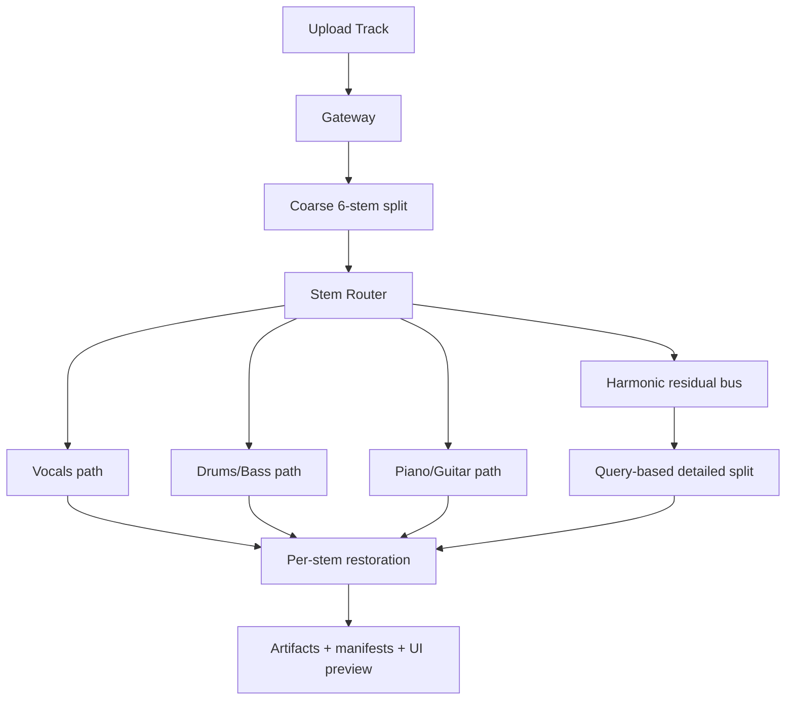

# Архитектура

## Главная идея

Система разделена не по “одной модели на всё”, а по ролям.

## Контейнеры

### 1. frontend
Единый UI для:
- выбора пресета,
- запуска job,
- просмотра маршрутизации по stem'ам,
- просмотра логов,
- A/B сравнения.

### 2. api
Gateway / orchestrator:
- читает preset,
- собирает pipeline,
- вызывает worker-сервисы,
- сохраняет manifests,
- отдаёт UI каталоги и состояние job.

### 3. demucs-worker
Роль:
- coarse split,
- drums/bass specialist,
- validation against another architecture.

### 4. bsroformer-worker
Роль:
- базовый 6-stem backbone,
- vocals-focused и instrumental-focused cleanup модели,
- dereverb / resurrection family.

### 5. audio-separator-worker
Роль:
- ансамбли,
- community-tested presets,
- fallback / blend / denoise path.

### 6. querysep-worker
Роль:
- extraction beyond fixed 6 stems,
- prompt/query-based separation,
- long-tail инструментальные классы.

### 7. restoration-worker
Роль:
- targeted per-stem cleanup,
- dereverb,
- harmonic smoothing,
- future expert restorers.

## Поток обработки

## Почему именно так

Потому что у fixed multi-output моделей есть ограничение:
- они хорошо работают на частых классах,
- но плохо масштабируются на длинный хвост инструментов,
- а `other` быстро превращается в мусорный контейнер.

Поэтому:
- сначала coarse split,
- потом per-stem specialized path,
- потом long-tail split,
- потом restoration.

## Shared storage

Все сервисы работают через общие тома:
- `data/input`
- `data/jobs`
- `data/output`
- `models`

## Почему нет “одной супер-модели на всё”

Потому что тебе нужно:
- и чистый вокал,
- и хорошие drums/bass,
- и нормальные piano/guitar,
- и ещё long-tail категории вроде strings/synth/reeds/brass/organ.

Обычно один backbone не лучший сразу во всех этих ролях.
